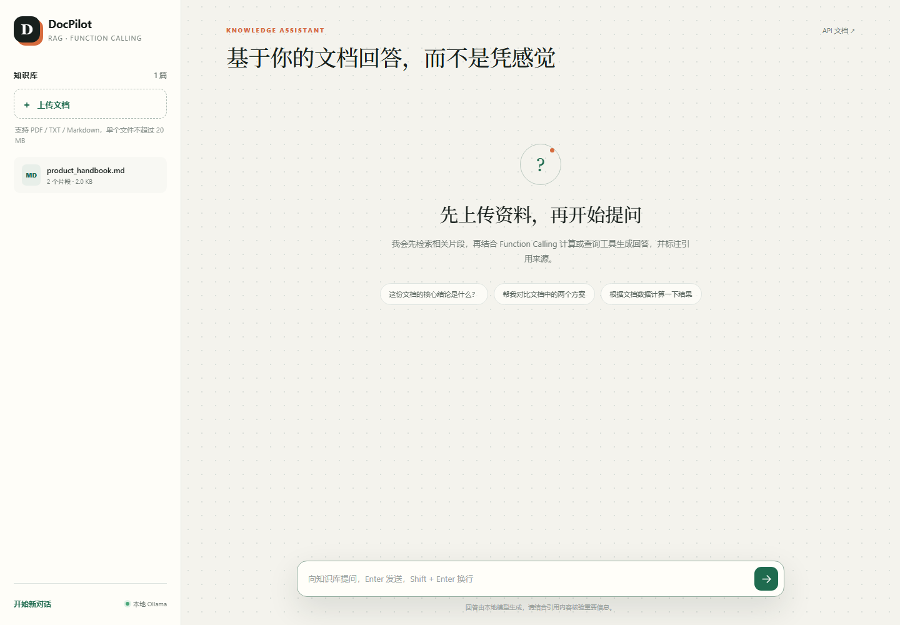
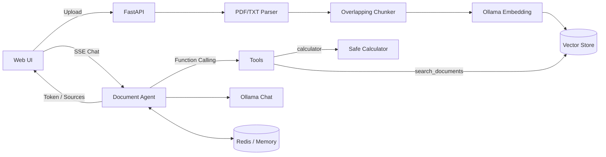

# DocPilot · RAG + Function Calling 文档问答 Agent

一个本地优先的文档问答项目：上传 PDF / TXT / Markdown，系统完成解析、切块、向量化、检索与重排，再由本地大模型通过 Function Calling 调用检索、文档列表和计算工具生成带引用的回答。



> 这是一个用于学习与作品展示的可运行项目，不宣称生产级性能。项目提供真实的检索与工具调用链路，但不包含虚构的业务指标。

## 功能

- 文档上传、解析与删除，支持 PDF、TXT、Markdown；
- 重叠切块 + 向量检索 + 轻量词法重排的两阶段召回；
- 通过 Ollama 本地运行 Chat 与 Embedding 模型；
- Function Calling 工具：`search_documents`、`list_documents`、`calculator`；
- SSE 流式返回回答、工具状态与引用来源；
- Redis 保存多轮会话，未配置 Redis 时自动使用内存会话；
- 默认使用无额外依赖的本地持久化向量索引，可选切换 ChromaDB；
- Docker / Docker Compose 部署与基础测试。

## 架构



### 检索流程

1. 文档按字符切块，优先在段落或句子边界截断，默认 `700` 字符、`120` 字符重叠；
2. 使用 `nomic-embed-text` 生成向量，写入本地索引或 Chroma；
3. 查询时先召回默认 8 个候选片段；
4. 使用轻量词法重排器结合向量分数与中文/英文词项重合度，保留默认 4 个片段；
5. 模型基于片段回答，并输出 `[1]`、`[2]` 形式的引用编号。

重排器目前是**词法重排**，不是 Cross-Encoder。这样首次运行不需要再下载一个重排模型，后续可以在 `app/services/reranker.py` 中替换为 BGE Reranker 等服务。

如果所选模型不支持 tools，系统会自动改为“先检索、再回答”的降级链路；如果模型直接回答但跳过了检索，系统也会强制重新检索，避免把无依据的内容当成文档结论。

## 快速开始

### 1. 准备 Ollama

```bash
ollama serve
ollama pull qwen2.5:7b
ollama pull nomic-embed-text
```

如果机器显存有限，可以把 `CHAT_MODEL` 换成更小的模型。请确保模型支持工具调用。

### 2. 启动项目

Windows PowerShell / CMD：

```bat
python -m venv .venv
.venv\Scripts\activate
pip install -r requirements.txt
copy .env.example .env
uvicorn app.main:app --reload --port 8000
```

macOS / Linux：

```bash
python -m venv .venv
source .venv/bin/activate
pip install -r requirements.txt
cp .env.example .env
uvicorn app.main:app --reload --port 8000
```

打开 <http://localhost:8000>。接口文档位于 <http://localhost:8000/docs>。

### 3. 可选：启用 ChromaDB

```bash
pip install -r requirements-vector.txt
```

在 `.env` 中设置：

```dotenv
VECTOR_BACKEND=chroma
```

### 4. 可选：启用 Redis

```bash
docker run --name docpilot-redis -p 6379:6379 -d redis:7-alpine
```

```dotenv
REDIS_URL=redis://localhost:6379/0
```

Redis 不可用时，应用会自动回退到内存会话，不会阻止启动。

## Docker Compose

Ollama 建议运行在宿主机，Compose 只启动应用和 Redis：

```bash
docker compose up --build
```

Windows / macOS 通过 `host.docker.internal` 访问宿主机 Ollama；Linux 已配置 `host-gateway`。

## 配置

| 变量 | 默认值 | 说明 |
| --- | --- | --- |
| `OLLAMA_BASE_URL` | `http://localhost:11434` | Ollama 地址 |
| `CHAT_MODEL` | `qwen2.5:7b` | 对话模型，需要支持 tools |
| `EMBEDDING_MODEL` | `nomic-embed-text` | 向量模型 |
| `OLLAMA_NUM_CTX` | `8192` | 模型上下文窗口 |
| `CHUNK_SIZE` | `700` | 切块字符数 |
| `CHUNK_OVERLAP` | `120` | 相邻块重叠字符数 |
| `RETRIEVE_TOP_K` | `8` | 向量召回数量 |
| `RERANK_TOP_N` | `4` | 重排后保留数量 |
| `MAX_FILE_MB` | `20` | 上传大小上限 |
| `VECTOR_BACKEND` | `local` | `local` 或 `chroma` |
| `REDIS_URL` | 空 | 为空时使用内存会话 |
| `DATA_DIR` | `data` | 数据与索引目录 |

完整配置见 [.env.example](.env.example)。

## API

| 方法 | 路径 | 说明 |
| --- | --- | --- |
| `GET` | `/health` | 健康状态与索引统计 |
| `GET` | `/api/documents` | 文档列表 |
| `POST` | `/api/documents` | 上传并索引文档 |
| `DELETE` | `/api/documents/{id}` | 删除文档与向量 |
| `POST` | `/api/chat` | SSE 问答 |
| `DELETE` | `/api/sessions/{id}` | 清除会话 |

调用示例：

```bash
curl -X POST http://localhost:8000/api/documents \
  -F "file=@sample_docs/product_handbook.md"

curl -N -X POST http://localhost:8000/api/chat \
  -H "Content-Type: application/json" \
  -d '{"question":"标准版包含哪些功能？","session_id":"demo"}'
```

## 测试

```bash
pip install -r requirements-dev.txt
pytest
```

测试覆盖切块、重排、安全计算器、本地向量索引和健康检查，不依赖真实模型。

## 项目结构

```text
app/
  main.py                 FastAPI 入口与 SSE 接口
  config.py               环境配置
  services/
    agent.py              Function Calling 对话流程
    knowledge_base.py     文档入库、删除与检索
    documents.py          PDF/TXT/Markdown 解析
    chunking.py           重叠切块
    reranker.py           轻量词法重排
    vector_store.py       本地索引与 Chroma 适配器
    tools.py              工具定义与安全计算器
    sessions.py           Redis / 内存会话
  static/                 原生 HTML/CSS/JS 页面
tests/
sample_docs/
```

## 已知限制

- 扫描版 PDF 不含文本层，需要先做 OCR；
- 本地 JSON 向量索引适合单进程、小规模文档，大规模数据建议使用 Chroma 或其他向量数据库；
- 词法重排对同义表达的能力弱于 Cross-Encoder；
- 模型回答质量取决于所选 Ollama 模型，重要信息仍需核对引用；
- 当前没有账号体系，公网部署前应增加鉴权、限流和上传文件安全校验。

## License

[MIT](LICENSE)
